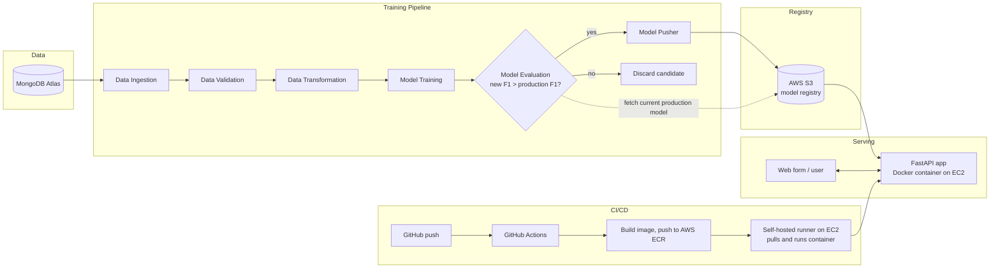

# Policy-Predilytics

**An end-to-end MLOps pipeline that predicts whether a vehicle insurance customer will respond to a cross-sell offer, from raw data in MongoDB to a containerised model served on AWS.**


---

## TL;DR for reviewers

| | |
|---|---|
| **Problem** | An insurer wants to know which existing customers are likely to buy a vehicle insurance policy, so sales teams can prioritise outreach. |
| **Solution** | A modular, production-style ML system: ingest, validate, transform, train, evaluate against the live model, and publish only improvements. A FastAPI app serves predictions. |
| **What makes it "MLOps"** | Pipeline stages with typed config and artifacts, schema-based data validation, a model registry on S3, a champion/challenger promotion gate, Docker packaging and a CI/CD workflow. |
| **Data** | About 381,000 customer records, 12 columns, with a highly imbalanced target (`Response`). |
| **Model** | Random Forest classifier, with SMOTEENN used to rebalance the training data. |
| **Run it** | `python demo.py` to train, `python app.py` to serve (see [Quick start](#quick-start)). |

### Skills this project demonstrates

| Area | Evidence in this repo |
|---|---|
| **ML engineering** | Feature scaling with `ColumnTransformer`, imbalance handling with SMOTEENN, Random Forest training, F1/precision/recall evaluation |
| **Software design** | Component-based architecture, config and artifact dataclasses, custom exception handling, rotating-file logging, installable local package |
| **Data engineering** | MongoDB as the source of truth, schema-driven validation (`config/schema.yaml`), reproducible train/test split, per-run timestamped artifacts |
| **Cloud (AWS)** | S3 model registry, ECR image repository, EC2 deployment target, IAM-based access |
| **DevOps** | Dockerfile, GitHub Actions CI/CD workflow, self-hosted runner on EC2, secrets via GitHub Secrets |
| **Backend / API** | FastAPI app with HTML form UI, `/train` and prediction endpoints, Jinja2 templating |

---

## Table of contents

1. [Business problem](#business-problem)
2. [Architecture](#architecture)
3. [The pipeline, stage by stage](#the-pipeline-stage-by-stage)
4. [Dataset](#dataset)
5. [Tech stack](#tech-stack)
6. [Project structure](#project-structure)
7. [Quick start](#quick-start)
8. [Using the web app](#using-the-web-app)
9. [Docker and CI/CD deployment](#docker-and-cicd-deployment)
10. [Design decisions](#design-decisions)
11. [Results](#results)
12. [Known limitations and roadmap](#known-limitations-and-roadmap)
13. [Authorship](#authorship)

---

## Business problem

Insurers hold large customer bases but have limited sales capacity. Calling every customer about a new vehicle policy is expensive and annoying for people who will never buy. If the company can rank customers by their likelihood of saying "yes", the sales team can focus on the best leads, which means better conversion at lower cost.

Policy-Predilytics frames this as **binary classification**: given customer, vehicle and policy attributes, predict `Response` (1 = interested, 0 = not interested).

The harder engineering question this project answers is not only "can we train a model?" but "**how do we train, validate, version, promote and serve it reliably, repeatedly, and without manual steps?**"

---

## Architecture



**Flow in one paragraph:** raw records live in MongoDB. The training pipeline pulls them, checks them against a schema, transforms them, trains a model and compares it with the model currently in production on S3. Only a better model gets published. The serving app loads the published model from S3 to answer prediction requests. Code changes flow through GitHub Actions, which builds a Docker image, stores it in ECR and runs it on an EC2 machine.

---

## The pipeline, stage by stage

Each stage is its own class under `src/components/`. It takes a typed **config** and the previous stage's typed **artifact** as input, and returns its own artifact. This makes every stage independently testable and easy to replace. `TrainPipeline` in `src/pipline/training_pipeline.py` wires them together.

| # | Stage | What it does | Key output |
|---|---|---|---|
| 1 | **Data ingestion** | Reads the whole collection from MongoDB, writes a CSV "feature store", and splits it 75% train / 25% test | `train.csv`, `test.csv` |
| 2 | **Data validation** | Checks column count and that every required numerical and categorical column from `config/schema.yaml` is present in both train and test; writes a JSON report | `report.yaml` (JSON content), validation status |
| 3 | **Data transformation** | Maps `Gender` to 0/1, drops the ID column, one-hot encodes categoricals, scales numeric features (`StandardScaler` on Age and Vintage, `MinMaxScaler` on Annual_Premium), then applies **SMOTEENN** to handle class imbalance | `preprocessing.pkl`, transformed train/test `.npy` arrays |
| 4 | **Model training** | Trains a `RandomForestClassifier` (200 trees, max depth 10, entropy criterion), computes F1, precision and recall, enforces a minimum accuracy gate, and bundles preprocessor and model into one `MyModel` object so serving cannot drift from training | `model.pkl` |
| 5 | **Model evaluation** | Loads the current production model from S3 (if any), scores it on the same test data, and accepts the new model only if its F1 is higher | `is_model_accepted` flag |
| 6 | **Model pusher** | Uploads the accepted model to the S3 bucket, which acts as the model registry | S3 object |

Every run writes to a timestamped folder under `artifact/`, so runs never overwrite each other and are easy to trace.

### Cross-cutting engineering

- **Configuration:** constants live in `src/constants`, and dataclasses in `src/entity/config_entity.py` and `artifact_entity.py` turn them into per-stage configs and typed outputs.
- **Logging:** `src/logger` writes to both console and a rotating log file (5 MB, 3 backups).
- **Error handling:** `src/exception` provides `MyException`, which reports the failing file, line number and message.
- **Packaging:** `setup.py` / `pyproject.toml` make `src` an installable package (`pip install -e .`), so imports work identically on a laptop, in Docker and in CI.
- **Secrets:** credentials are read from environment variables, never committed.

---

## Dataset

- **Size:** 381,109 rows, 12 columns (`notebook/data.csv`).
- **Target:** `Response` (1 = interested in the policy, 0 = not interested). Positive cases are a small minority, which is why SMOTEENN is used.

| Column | Type | Meaning |
|---|---|---|
| `id` | int | Unique customer ID (dropped before training) |
| `Gender` | category | Male / Female |
| `Age` | int | Customer age |
| `Driving_License` | int | 1 if the customer holds a driving licence |
| `Region_Code` | float | Code for the customer's region |
| `Previously_Insured` | int | 1 if the customer already has vehicle insurance |
| `Vehicle_Age` | category | `< 1 Year`, `1-2 Year`, `> 2 Years` |
| `Vehicle_Damage` | category | Whether the vehicle was damaged in the past |
| `Annual_Premium` | float | Premium paid per year |
| `Policy_Sales_Channel` | float | Code for the outreach channel |
| `Vintage` | int | Days the customer has been with the company |
| `Response` | int | **Target** |

Exploratory analysis and the hyperparameter search (`RandomizedSearchCV`) are documented in `notebook/exp-notebook.ipynb`.

---

## Tech stack

| Layer | Tools |
|---|---|
| Language | Python 3.10 |
| ML | scikit-learn, imbalanced-learn (SMOTEENN), pandas, NumPy |
| Data store | MongoDB Atlas (via `pymongo`) |
| Model registry | AWS S3 (via `boto3`) |
| Serving | FastAPI, Uvicorn, Jinja2 |
| Packaging | setuptools, `dill` for model serialisation |
| Containers | Docker |
| CI/CD | GitHub Actions, AWS ECR, AWS EC2 (self-hosted runner) |
| Analysis | Jupyter, matplotlib, seaborn, plotly |

---

## Project structure

```
Policy-Predilytics/
├── app.py                        # FastAPI app (UI, prediction and training routes)
├── demo.py                       # Runs the full training pipeline from the command line
├── Dockerfile                    # Container image for the web app
├── setup.py / pyproject.toml     # Makes `src` an installable local package
├── requirements.txt
├── config/
│   ├── schema.yaml               # Expected columns, types and feature groups
│   └── model.yaml
├── notebook/
│   ├── data.csv                  # Dataset
│   ├── exp-notebook.ipynb        # EDA, preprocessing and model experiments
│   └── mongoDB_demo.ipynb        # Loads the CSV into MongoDB
├── src/
│   ├── components/               # ingestion, validation, transformation, trainer, evaluation, pusher
│   ├── pipline/                  # training_pipeline.py, prediction_pipeline.py
│   ├── entity/                   # config + artifact dataclasses, MyModel, S3 estimator
│   ├── configuration/            # MongoDB and AWS connection helpers
│   ├── cloud_storage/            # S3 wrapper (upload, download, existence checks)
│   ├── data_access/              # MongoDB collection to DataFrame
│   ├── constants/                # All tunable constants in one place
│   ├── utils/                    # YAML, pickle and NumPy helpers
│   ├── logger/                   # Logging setup
│   └── exception/                # Custom exception
├── static/css/                   # Web UI styles
├── templates/                    # HTML form
└── .github/workflows/aws.yaml    # CI/CD workflow (disabled by default, see below)
```

> The folder is named `pipline` (sic) in the code. Keep that spelling, or rename it everywhere consistently.

---

## Quick start

### Prerequisites

- Python 3.10 (conda or venv)
- A free [MongoDB Atlas](https://www.mongodb.com/cloud/atlas) cluster
- An AWS account with an S3 bucket (needed for model evaluation, pushing and serving)

### 1. Install

```bash
git clone https://github.com/shubhamkapase07/Policy.Predilytics.git
cd Policy.Predilytics

conda create -n policy-predilytics python=3.10 -y
conda activate policy-predilytics
pip install -r requirements.txt
```

### 2. Set up MongoDB Atlas and load the data

1. Create a free MongoDB Atlas cluster.
2. Under **Security → Database Access**, create a database user with a strong password. Give it `readWrite` access to the `Proj1` database.
3. Under **Security → Network Access**, add your current IP address.
4. In the cluster, choose **Connect → Drivers**, select Python, and copy the connection string. Replace `<db_password>` with your database user's password. If the password contains special characters, URL-encode them.
5. Set the connection string in your environment, then run `notebook/mongoDB_demo.ipynb`. The notebook reads the URL from the environment instead of storing credentials in the notebook.

```bash
# Bash
export MONGODB_URL="mongodb+srv://<username>:<password>@<cluster>.mongodb.net/"

# PowerShell
$env:MONGODB_URL = "mongodb+srv://<username>:<password>@<cluster>.mongodb.net/"
```

The notebook writes to database `Proj1`, collection `Proj1-Data` (set in `src/constants/__init__.py`). MongoDB creates them on the first insert if they do not already exist. Keep your real connection string private.

### 3. Configure AWS

Create an IAM user (use least-privilege permissions for S3 rather than administrator access in anything beyond a demo), create an S3 bucket, and set:

```bash
export AWS_ACCESS_KEY_ID="<your-access-key>"
export AWS_SECRET_ACCESS_KEY="<your-secret-key>"
```

Then set `MODEL_BUCKET_NAME` and `REGION_NAME` in `src/constants/__init__.py` to your own bucket and region. **S3 bucket names are globally unique, so you cannot reuse the original name.**

### 4. Train

```bash
python demo.py
```

This runs ingestion, validation, transformation, training, evaluation and (if the model is accepted) pushes it to S3. Logs go to `logs/`, artifacts to `artifact/<timestamp>/`.

### 5. Serve

```bash
python app.py
```

Open <http://localhost:5000>.

---

## Using the web app

| Route | Method | Purpose |
|---|---|---|
| `/` | GET | Renders the prediction form |
| `/` | POST | Takes the form values and returns `Response-Yes` or `Response-No` |
| `/train` | GET | Triggers the full training pipeline from the browser |

The form takes the 11 model inputs: Gender (1 = male, 0 = female), Age, Driving_License, Region_Code, Previously_Insured, Annual_Premium, Policy_Sales_Channel, Vintage, Vehicle_Age_lt_1_Year, Vehicle_Age_gt_2_Years and Vehicle_Damage_Yes.

---

## Docker and CI/CD deployment

**Build and run locally**

```bash
docker build -t policy-predilytics .

docker run -p 5000:5000 \
  -e AWS_ACCESS_KEY_ID="<key>" \
  -e AWS_SECRET_ACCESS_KEY="<secret>" \
  -e AWS_DEFAULT_REGION="us-east-1" \
  -e MONGODB_URL="<mongodb-url>" \
  policy-predilytics
```

**Training run in GitHub Actions**

`.github/workflows/project-run.yml` runs on pushes and pull requests to `main`, or by manual dispatch from the Actions tab. It starts a temporary MongoDB service, loads the sample dataset, runs the training pipeline against a local S3 emulator, and checks a prediction. It requires no Atlas or AWS credentials. The trained model is uploaded as a downloadable workflow artifact for seven days; this does not deploy the app.

**Automated deployment (GitHub Actions to AWS)**

The AWS deployment example is archived as `.github/workflows/aws.yaml.disabled`; it is not an active workflow and has not been configured or tested. The active `project-run.yml` workflow above does not deploy to AWS.

---

## Design decisions

- **Typed configs and artifacts between stages.** Each stage only knows its inputs and outputs, so it can be tested, swapped or rerun in isolation.
- **Preprocessing and model saved as one object.** Serving applies exactly the transformations used in training, which removes a common source of training/serving skew.
- **Champion/challenger promotion.** A new model replaces production only if it beats the current one on F1, so a bad retrain cannot silently degrade the live system.
- **F1 as the promotion metric.** With an imbalanced target, plain accuracy is misleading. F1 balances precision and recall on the minority class.
- **SMOTEENN for imbalance.** It combines oversampling the minority class (SMOTE) with cleaning noisy samples (ENN), rather than only duplicating rows.
- **Schema file as the contract.** Expected columns live in `config/schema.yaml`, not scattered through the code.
- **Timestamped artifact folders.** Every run is traceable and reproducible.

---

## Results

Metrics depend on the data snapshot, split and hyperparameters, so run the pipeline to get your own numbers. Each run logs the evaluation metrics to `logs/` and the console; record yours here after training:

| Metric | Value |
|---|---|
| F1 score | _fill in after running_ |
| Precision | _fill in after running_ |
| Recall | _fill in after running_ |

---

## Known limitations and roadmap

I'd rather be upfront about what a production system would still need. These are the next improvements I would make:

- [ ] **Evaluation hygiene:** apply SMOTEENN only to training data, so the test set reflects the real class distribution, and gate on held-out rather than training accuracy.
- [ ] **Automated tests:** unit tests for each component and an integration test for the pipeline, run in CI before the image is built.
- [ ] **Model versioning:** store models under versioned S3 keys (for example `model-registry/<timestamp>/model.pkl`) with a pointer to the current one, enabling rollback.
- [ ] **Experiment tracking:** log parameters, metrics and artifacts with MLflow.
- [ ] **Monitoring:** data drift and prediction drift checks, plus alerting.
- [ ] **Security:** replace long-lived access keys with IAM roles, restrict CORS, and protect `/train` with authentication.
- [ ] **Serving performance:** cache the loaded model in memory instead of downloading it from S3 on every request, and run training as a background job.
- [ ] **Infrastructure as code:** provision S3, ECR and EC2 with Terraform.

---

## Authorship

This project was independently prepared by Shubham Kapase, following lessons from Vikash Das's lectures.

## Contact

**Shubham Kapase** · [LinkedIn](https://www.linkedin.com/in/shubhamkapase07/) · [GitHub](https://github.com/shubhamkapase07) · shubhamkapase.96@gmail.com